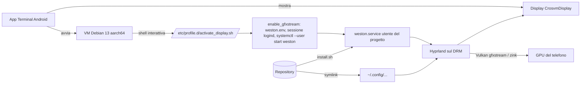

# Context and main flows

- **Installazione:** l'utente clona il repository nella VM ed esegue `install.sh`, che installa i pacchetti, collega i dotfile e l'override della sessione.
- **Avvio:** aprendo il display dall'app Terminal, lo script di sistema avvia "weston"; l'override fa partire Hyprland sul DRM, che legge la configurazione collegata e avvia le applicazioni della sessione.
- **Ritorno a Weston:** rimuovendo l'override torna attiva l'unità di sistema di Weston.
